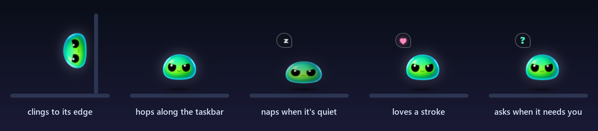
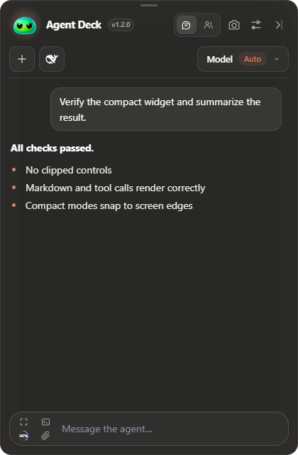
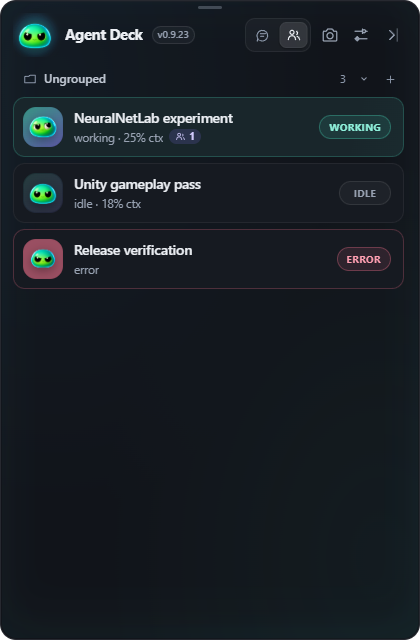
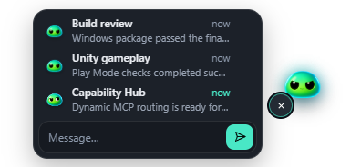
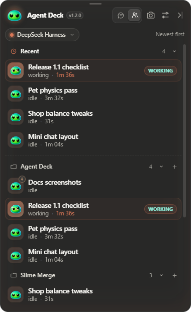
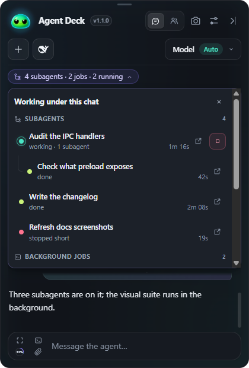
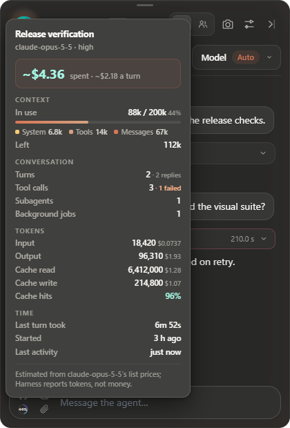

<p align="center">
  
</p>
<h1 align="center">NeoXider Agent Deck</h1>
<p align="center"><strong>Your agents, within reach. And a slime that lives on your desktop.</strong><br>
A desktop chat for DeepSeek Harness, a live session board, a little pet that climbs your screen, or just a glowing hinge.</p>
<p align="center">
  
  <a href="CHANGELOG.md"></a>
  <a href="https://github.com/NeoXider/neoxider-agent-deck/actions/workflows/ci.yml"></a>
  
  
  
  <a href="https://github.com/deepseek-ai/deepseek-harness"></a>
  <a href="LICENSE"></a>
</p>
<p align="center"><a href="https://github.com/NeoXider/neoxider-agent-deck/releases/latest"><strong>Download</strong></a> · <a href="#meet-the-pet">Meet the pet</a> · <a href="#get-started">Get started</a> · <a href="CHANGELOG.md">What's new</a> · <a href="SECURITY.md">Security</a></p>

Agent Deck brings [DeepSeek Harness](https://github.com/deepseek-ai/deepseek-harness) onto your desktop. Follow several agents at once, carry on a conversation, change models, answer an agent's question and share a screenshot without leaving what you are doing. Fold the chat away when you need the room and a green slime keeps you company instead: it tells you when an agent finishes, asks you when one needs you, and spends the rest of its time climbing, hopping and napping around your screen.

## Meet the pet

<p align="center"></p>

Fold the widget and it becomes a slime. The slime is a proper desktop pet, built the way the classics are (Shimeji, eSheep, oneko): a small state machine picks its next move by weight, gravity is real, and it rests far more than it moves.

| It… | When |
|---|---|
| **clings to its screen edge** and inches up and down it | most of the time; the edge is home |
| **drops to the taskbar** and lands with a squash | now and then, under real gravity |
| **hops along the taskbar**, looks around, sits, scoots | when nothing needs you, never past the middle of the screen |
| **climbs back home** | after a while away, or whenever it feels like it |
| **naps** with its eyes shut, z's floating up | after a minute and a half of quiet; the pointer or any agent wakes it |
| **blushes and squishes** with a ♥ | when you stroke it: move the pointer back and forth over it |
| **flies** where you throw it | grab it and fling it; it bounces off the top of the screen and lands on the taskbar or its wall |
| **splats** into drops and pulls itself back together | after a high fall or a hard throw at its wall; the harder the hit, the farther the drops fly. A short hop down only squashes it |
| **holds still** | while you point at it, a notification or the panel is open, an agent works, or motion is reduced |
| **nudges you** with a **?**, looking curious, or with a **!** | when an agent asks a question or fails |
| **celebrates** | when an agent finishes |

Its glow is its own silhouette in the colour of what the agents are doing. Hover it and three little buttons appear: recent chats, **status** (the eye: every message the agent writes, or only finished replies), and folding into the screen edge. Pet mode can be switched off in **Settings → Pet mode**; the slime then stays put at its edge.

## Four ways to stay connected

<table>
<tr><td width="50%" align="center"><strong>Chat</strong><br>Messages, tools, attachments and model controls.<br></td><td width="50%" align="center"><strong>Sessions</strong><br>See who's working and jump into any session.<br></td></tr>
<tr><td align="center"><strong>Avatar</strong><br>The slime, with recent chats and a message box.<br></td><td align="center"><strong>Hinge</strong><br>A discreet status handle at the screen edge.<br></td></tr>
</table>

These are screenshots of the UI with demonstration sessions. Avatar and Hinge are called Orb and Edge in some internal settings and diagnostics. Hover the hinge and a little slime peeks out above it: click it to become the avatar again.

## Small window. Full conversation.

- **Answer the agent here.** When an agent stops on a question, it appears above the message box with its options. Answer or skip without opening the browser.
- **Chats from the avatar.** Click a recent chat to address the message box to it, click again to open it in a small window that grows up out of the slime's panel. After you send, it folds back into the avatar.
- **Subagents in sight.** The chip under the Thinking line counts subagents and background jobs as working/total (`Subagents 2/29 · Jobs 1/3`); open it to see each one working, stop it, read a job's output, or open a subagent as a chat of its own and write to it.
- **Fast on long chats.** A chat opens on its newest messages and fetches older ones as you scroll; a chat of thousands of messages opens in a fraction of a second, and one you opened before is back instantly.
- **Open what the chat points at.** Click an image, an attached file, a link to a file or a path an agent writes, and it opens in a viewer window: images to zoom, Markdown to read, code highlighted at the line named.
- **What it cost.** Hover the context meter: spend and cost per turn, context and what fills it, turns and tool calls, tokens and cache hits, time worked.
- **Pin, delete, undo.** Pin a chat to the top of its group or delete it from its card's menu; deleting archives it the way DSH does, and Undo brings it back.
- **One model and effort control.** Open the combined chip, adjust reasoning on the slider, or choose another model from the same menu.
- **Readable activity.** Streaming Markdown, grouped tools, queued messages, a compact goal strip and context usage. Background jobs have their own waiting state.
- **Motion that feels like a Mac.** Folding shrinks the window into the slime or the edge on a spring and it grows back out the same way. Buttons, menus and new tool calls bounce a little.
- **Your space, your look.** Claude (the Claude Code colours, the default), Aurora, Graphite, Midnight, Cyberpunk and Cave themes; custom images, saved design profiles, separate background and text opacity.
- **Screenshots in one shortcut.** Capture for review, or send the current screen straight to the selected chat. Deck stays on screen but out of the picture.
- **Harness taken care of.** No DeepSeek Harness installed? Deck installs it. A new stable release? Deck says so once and puts a **DSH x.y.z** chip in the title bar; one press installs it next to the running one and switches. Running DSH Desktop instead? Deck can follow its Harness too.

<table>
<tr><td width="33%" align="center"><strong>Agents</strong><br>Newest first, pins on top, Recent above the groups.<br></td><td width="33%" align="center"><strong>Subagents</strong><br>Everything working under a chat, stoppable.<br></td><td width="33%" align="center"><strong>What it cost</strong><br>Hover the context meter.<br></td></tr>
</table>

## Get started

1. Download the installer or portable build from [Releases](https://github.com/NeoXider/neoxider-agent-deck/releases/latest). The source version may be newer than the latest public release.
2. Start Harness Web at `http://127.0.0.1:3080`, or press **Start** in Deck's offline banner. With no Harness on the machine, Deck installs the stable DeepSeek Harness runtime with npm (Node.js 22+ required) and starts that.
3. If Harness asks for authentication, use **Connect** and paste the `dsh web:` launch URL once. Pick a session and start chatting.

Deck updates itself through **Settings → Updates** and keeps Harness current through **Settings → DeepSeek Harness**: it checks npm every few hours for a newer stable release, announces it, and installs and switches to it when you press **Update**, never on its own, so agents are not cut off mid-turn. The same section picks which Harness Deck follows: its own, the one inside DSH Desktop, or whichever is running. Windows is the primary target; macOS and Linux packages are experimental. Current builds are unsigned, so SmartScreen or Gatekeeper may ask for confirmation.

### Window layers and private capture

| Layer | Behaviour |
|---|---|
| Desktop | Desktop layer: every ordinary window covers the widget, including compact modes. |
| Above | Stays above ordinary app windows. |
| **Always on top+** | Reasserts its position above ordinary and borderless windows. |
| **Private overlay** | Windows only: stays above apps and requests exclusion from supported screenshots and screen sharing. |

Private overlay uses Windows capture exclusion through [Electron content protection](https://www.electronjs.org/docs/latest/api/browser-window#winsetcontentprotectionenable). On Windows 10 version 2004 and newer, supported capture methods omit the window; older versions may show a black area. Some recording methods can ignore the request. It is not a guarantee against every capture tool, nor does any layer guarantee visibility over exclusive fullscreen games. A native [Xbox Game Bar companion](windows-gamebar/README.md) is available separately.

### Shortcuts

All shortcuts can be changed or disabled in **Settings → Shortcuts**.

| Default shortcut | Action |
|---|---|
| Ctrl+Alt+Shift+Space | Show Deck; press again to collapse it back to the avatar or strip |
| Ctrl+Alt+Shift+F | Toggle Focus chat |
| Ctrl+Alt+Shift+A / E | Collapse to Avatar / Hinge |
| Ctrl+Alt+Shift+N | New session |
| Ctrl+Alt+Shift+H | Open the current session in Harness |
| Ctrl+Alt+Shift+D / S | Capture display / region for review |
| **Ctrl+Alt+Shift+Enter** | **Capture the monitor under the pointer and send it immediately** |

Immediate capture keeps your draft and foreground focus. The snapshot goes to the session selected when the shortcut was pressed. On macOS, use Command in place of Ctrl for supported shortcuts.

### Open Harness from your phone

Enable **Device access on Wi-Fi** in the tray menu. Open the phone address on the same trusted network, request access, compare the code and approve the browser on your computer. Deck keeps Harness authentication inside its local proxy; you do not need to copy a launch token to the phone.

## Run from source

Requires Node.js 22+ and a Harness Web profile.

```powershell
git clone https://github.com/NeoXider/neoxider-agent-deck.git
cd neoxider-agent-deck
npm ci
npm start
```

Set `DSH_WIDGET_URL` for a different Harness endpoint. Source version 1.2.2 shows where DeepSeek Harness 0.2.1 compacted a chat, keeps the Thinking card to thinking, lists the newest subagent and job answers first, and shows a model on your own machine as free. 1.2.1 stays smooth while many chats stream at once: a streaming answer is formatted a block at a time, the conversation no longer makes the panel measure the whole transcript on every word, and chats already streaming live are not re-read on every poll. 1.2.0 lets you write to a continuable subagent from its chat, wears the Claude Code colours as its default theme, counts subagents and jobs as working/total under the Thinking line, and keeps Thinking steady in a subagent's chat. 1.1.3 opens a subagent's chat again on DeepSeek Harness 0.2.1, which refused to show it. 1.1.2 installs a downloaded update by itself while Deck sits as the avatar or strip with nothing typed, attached or sending, and makes the show shortcut collapse the widget back when pressed again. 1.1.1 keeps the avatar a plain pet while Harness is off, with no card or notification beside it. 1.1.0 opens long chats at once, takes screenshots in a tenth of the time, follows DSH Desktop's Harness as well as its own, updates Harness to a new stable release with one press, shows a chat's subagents and background jobs and opens a subagent as a chat, pins and deletes chats, opens images and files from the chat in a viewer window, and shows what a chat has cost when you hover its context meter. 1.0.1 let you grab the pet and throw it. 1.0.0 turned the avatar into a desktop pet, answers the agent's questions inside Deck for real, opens a chat from the avatar as a small window beside it, installs and updates DeepSeek Harness, and makes folding and unfolding start at once with no flash. Every earlier release is in the [changelog](CHANGELOG.md).

## Verify and build

```powershell
npm test
npm run test:gate
npm audit --audit-level=high
npm run build
```

`npm run test:gate` runs the whole release gate in about four minutes: the unit tests, the visual suite on a pool of workers (`npm run test:ui`, or `node scripts/ui-visual-smoke.cjs --failed` to rerun only what failed), the Electron smokes, and `npm run test:scale`, a benchmark of forty sessions with thirteen streaming at once over a 2,400-message chat. Each suite's time and a rerun hint are printed at the end.

The tests cover session contracts, streaming, attachments, window geometry, compact layouts and the pet's behaviour. `npm run test:harness -- --entry /absolute/path/to/dsh/lib/bin.js` runs real Harness acceptance in an isolated home against a local deterministic model server without touching user chats or credentials. Add `--compaction` to exercise automatic and manual compaction. Release CI builds Windows, Intel and Apple Silicon macOS, Linux and the Game Bar companion, then publishes checksums with the artifacts. The Windows portable output is `release/NeoXider-Agent-Deck-1.2.2-windows-x64-portable.exe`.

## Trust and integration

Deck uses Harness RPC directly. It does not scrape the web UI or read provider API keys. The renderer is sandboxed; file preparation and requests pass through a narrow IPC bridge.

Sessions created or prompted through Deck are set to Harness **danger-full-access**. Agents may read, write, run commands and use configured tools without another permission prompt. Use trusted models, workspaces and MCP servers. See [SECURITY.md](SECURITY.md).

- [NeoXider MCP Hub](https://github.com/NeoXider/neoxider-mcp-hub): load tools on demand.
- [DSH background code integration](integrations/dsh-background-code/README.md): return long-running scripts as background jobs and deliver their completion to the agent.
- [DSH Agent Deck integration](integrations/dsh-agent-deck/README.md): open the Deck widget from a Harness session and check that it is installed, running and following the same Harness.
- [Architecture](ARCHITECTURE.md) · [Changelog](CHANGELOG.md) · [Roadmap](TODO.md)

MIT © NeoXider
